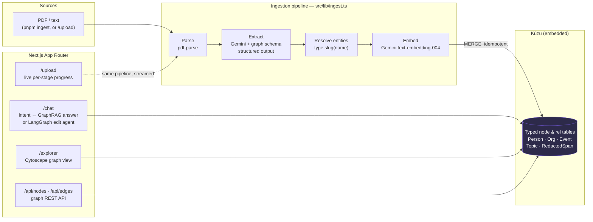

# Graphdossier

[](https://github.com/Rohankumar8124/graphdossier/actions/workflows/ci.yml)
[](LICENSE)


**Turn a pile of released FOIA/RTI documents into a navigable map of who knew what, when — and what's still redacted.**

Graphdossier is an end-to-end investigative tool for government transparency records. It reads released documents (PDF or text), uses an LLM constrained by a typed graph schema to extract the people, organizations, meetings, decisions, and topics inside them, and assembles everything into an **embedded Kùzu knowledge graph** you can question in plain English, edit through an agent, or explore visually.

Its signature idea: **every redaction is a first-class node in the graph.** A blacked-out span isn't an absence — it's a `RedactedSpan` node carrying its legal exemption code (b4 commercial, b5 deliberative, b6 privacy…) and the surrounding context that hints at what was concealed. Redactions become queryable investigative leads.

Built with **Gemini** (extraction + embeddings + answering), **Kùzu** (embedded property-graph database — no server to run), **LangGraph** (the graph-editing agent), and **Next.js / TypeScript**.

<p align="center">
  
</p>

### Contents

[Why this exists](#why-this-exists) · [Who it's useful for](#who-its-useful-for-and-the-impact) · [Feature tour](#what-it-does-feature-tour) · [Architecture](#architecture) · [Graph API](#graph-api) · [Getting started](#getting-started) · [Deploying](#deploying-cloud-run) · [Demo corpus](#the-demo-corpus-project-greenfield) · [Scripts](#scripts) · [Tech stack](#tech-stack) · [Roadmap](#roadmap)

---

## Why this exists

Millions of pages of government records are released every year through FOIA (US) and RTI (India) requests — and most of them are read by nobody. The information that matters is rarely in one document; it's in the *network across documents*: the same consultant appearing on both sides of a deal, a meeting that happens right before a decision, a report that vanishes from the record after one email.

Existing tools don't surface that network:

| Tool | What it does | What it misses |
| --- | --- | --- |
| DocumentCloud & full-text readers | Search the words | Relationships between entities across documents |
| Aleph (OCCRP) | Cross-reference entities | Tuned to leaks/sanctions data, heavy to operate |
| Manual review | Everything, eventually | Weeks of a journalist's time per dump |

Graphdossier reconstructs the **who-talked-to-whom-when** graph automatically, and — uniquely — treats what the government *chose to hide* as data. You can literally ask: *"What's hidden, and who's hiding it?"*

## Who it's useful for, and the impact

- **Investigative journalists** — a document dump that takes weeks to cross-reference by hand becomes an explorable graph in minutes. Alias resolution alone ("Robert Calloway" / "Bob" / "R. Calloway" → one Person node) removes an entire class of missed connections.
- **Civic-tech and transparency groups** — redaction patterns become measurable: which agencies redact most, under which exemptions, around which topics.
- **Researchers and students of public policy** — the graph is a dataset: meeting chains, decision timelines, and influence networks extracted from primary sources, grounded with citations back to the original documents.
- **Anyone filing RTI/FOIA requests** — knowing *what sits behind a b(4) redaction next to a contamination report* tells you exactly what to request next. Graphdossier turns redactions into a roadmap for the follow-up request.

The broader point: transparency laws only create accountability if someone can actually process what gets released. Graphdossier demonstrates that modern LLM + knowledge-graph pipelines can close that gap — the same GraphRAG architecture used on enterprise data, pointed at the public interest.

---

## What it does (feature tour)

- **Schema-guided extraction** — Gemini structured output constrained by a fully-specified Zod schema. The typed graph schema (`src/lib/graph-schema.ts`) is the single source of truth: node types (`Person`, `Organization`, `Document`, `Event`, `Topic`, `RedactedSpan`…), allowed relationship triples, and display colors. Extraction cannot invent types the graph doesn't know — and the same contract generates the database tables.
- **Entity resolution** — extracted entities are canonicalized (`type:slug(name)`) so aliases and repeated mentions across documents collapse into single nodes.
- **Redactions as data** — each `RedactedSpan` records its exemption code and surrounding context, is linked to its document and nearby entities, and is ringed in red in the explorer.
- **GraphRAG chat (`/chat`)** — questions are answered by semantic search over embedded documents, followed by one-hop graph expansion (including attached redactions), then a streamed Gemini answer grounded in the retrieved records.
- **Agentic graph editing (`/chat`)** — an intent classifier routes edit commands ("delete the node for Bob", "rename Project X", "connect Alice to Acme Corp") to a **LangGraph** ReAct agent whose tools mirror the public REST API one-to-one: it resolves fuzzy names to canonical ids first, and its mutations are validated against the schema's allowed triples — a link the schema forbids is refused with the list of what *is* allowed.
- **Graph REST API** — the same operations as first-class endpoints: create/search/rename/delete nodes, create/delete relationships (see [Graph API](#graph-api)).
- **Visual explorer (`/explorer`)** — the whole graph rendered with Cytoscape: filter by type, inspect nodes, follow the meeting chains.
- **Runtime ingestion with a live pipeline view (`/upload`)** — drop one or many PDFs/text files into the running app and watch the pipeline work in real time: a per-file queue with remaining count, a stage stepper (parse → extract → resolve → embed → write nodes → write edges) with live counts, per-edge activity messages, and an activity log. Progress streams from the server as NDJSON; one failed file doesn't stop the batch.
- **Field manual (`/guide`)** — a step-by-step walkthrough of the whole workflow (get a release → split it → upload → ask → explore → clean up by chat), what file formats and OCR path are supported, and where to find real FOIA/RTI releases to practice on.
- **Idempotent graph writes** — tables are created `IF NOT EXISTS` from the schema, ingestion uses `MERGE`; re-ingesting is safe.
- **Fail-fast configuration** — the environment is validated with Zod at boot (`src/lib/config.ts`), and the embedding dimension is measured at runtime rather than hardcoded.
- **Responsive UI** — the landing page, chat, explorer, and upload flows are usable on a phone: the graph explorer's legend and node-detail panels reflow into a bottom sheet on narrow screens instead of overlapping.

## Architecture

Graphdossier is two pipelines and an agent sharing one graph: an **ingestion pipeline** that turns raw documents into typed nodes and edges, a **retrieval pipeline** (GraphRAG) that turns a plain-English question into a grounded, streamed answer, and an **editing agent** that turns plain-English commands into schema-validated mutations. All three are schema-guided — nothing gets written or retrieved outside the types defined in `src/lib/graph-schema.ts`.



**Schema-guided, end to end.** `src/lib/graph-schema.ts` defines every node type, every allowed relationship triple, and display colors. The database tables are generated from it, extraction is constrained to it, and the editing agent's mutations are validated against it — the graph, chat retrieval, explorer, and API all read the same contract.

**Redactions are nodes, not gaps.** Each `RedactedSpan` is written like any other entity — exemption code, surrounding context, and edges to the document and entities it sits next to — so it's queryable and shows up in both chat answers and the explorer (ringed in red).

**Chat flow** (`src/app/api/chat/route.ts`): an intent classifier (structured output, with an obvious-verb fast path) decides between **Q&A** — embed the question, rank stored document embeddings by cosine in TypeScript, expand one hop (including redactions), stream a grounded Gemini answer — and **editing** — the LangGraph agent loops `find_nodes → (create|rename|delete|connect|disconnect)` until done and reports exactly what changed.

### Key modules

| File | Role |
| --- | --- |
| `src/lib/graph-schema.ts` | Single source of truth: node types, relationships, allowed triples, colors. `RedactedSpan` is a node type. |
| `src/lib/graphdb.ts` | Embedded Kùzu database: connection, table DDL generated from the schema, cosine ranking. |
| `src/lib/graph-ops.ts` | The mutation service layer shared by the REST API and the agent's tools. |
| `src/lib/agent.ts` | LangGraph ReAct agent for chat-driven graph editing. |
| `src/lib/intent.ts` | Chat intent classifier (question vs graph-edit). |
| `src/lib/config.ts` | Zod-validated env config (fails fast with a readable error). |
| `src/lib/gemini.ts` | Gemini chat + embeddings; embedding dimension measured at runtime. |
| `src/lib/extraction.ts` | Schema-guided extraction via Gemini structured output. |
| `src/lib/ingest.ts` | Extract → resolve entities (`type:slug(name)`) → embed → MERGE into the graph. |
| `src/lib/rag.ts` | GraphRAG: cosine document search + one-hop graph/redaction enrichment. |
| `src/app/api/*` | `chat` (NDJSON stream), `graph`, `nodes`, `edges`, `upload`, `stats`. |
| `src/components/GraphCanvas.tsx` | Cytoscape graph rendering. |
| `scripts/ingest.ts` | CLI ingestion from a corpus manifest. |

## Graph API

The graph is scriptable through plain REST endpoints — the same operations the chat agent uses:

| Method | Endpoint | Body / params | Does |
| --- | --- | --- | --- |
| `GET` | `/api/nodes?q=alice&type=Person` | — | Search nodes by partial name/id |
| `POST` | `/api/nodes` | `{type, name}` | Create (upsert) a node |
| `PATCH` | `/api/nodes/:id` | `{name}` | Rename a node |
| `DELETE` | `/api/nodes/:id` | — | Delete a node + its relationships |
| `POST` | `/api/edges` | `{sourceId, relationship, targetId}` | Create a relationship (schema-validated) |
| `DELETE` | `/api/edges` | `{sourceId, relationship, targetId}` | Delete a relationship |
| `GET` | `/api/graph?limit=500` | — | The whole graph for the explorer |
| `GET` | `/api/stats` | — | Node/edge counts |

Relationships outside the schema's allowed triples are rejected with a message listing what *is* allowed for that pair of node types.

## Getting started

### 1. Prerequisites

- Node 20+ and `pnpm`
- A **Gemini API key** — https://aistudio.google.com/apikey

That's it — the graph database is embedded (Kùzu); there is no database server to install or host.

### 2. Configure

```bash
cp .env.example .env.local
# fill in GEMINI_API_KEY
```

### 3. Install & load the demo corpus

```bash
pnpm install
pnpm ingest --reset    # builds the graph from the Project Greenfield corpus
```

### 4. Run

```bash
pnpm dev               # http://localhost:3000
```

Try it end to end: ask a question on `/chat`, then type `rename Robert Calloway to Bob Calloway` — the agent resolves the node and edits the graph; check `/explorer`.

## Deploying (Cloud Run)

The included `Dockerfile` targets Google Cloud Run's free tier. Because Cloud Run's filesystem is ephemeral, the pattern is **bake the ingested graph into the image**: run `pnpm ingest` locally (it writes `data/graphdossier.kuzu`), then deploy — the container ships with the graph inside. Runtime edits (agent mutations, uploads) live until an instance recycles, which is exactly right for a demo.

```bash
pnpm ingest --reset
gcloud run deploy graphdossier --source . --region asia-south1 \
  --allow-unauthenticated --memory 1Gi \
  --set-env-vars GEMINI_API_KEY=your-key
```

For durable runtime writes, promote the graph to a rebuild-and-redeploy flow (CI job runs ingest → new image) or mount object storage — future work.

> **Free-tier Gemini quota:** `aistudio.google.com` API keys on the free tier cap requests per model per day in the low tens, shared across *every* visitor to the deployed URL — a public demo link can exhaust it quickly. The app fails gracefully (a friendly "try again shortly" message instead of a raw error) when this happens; for durable public traffic, enable billing on the key's project to move to the pay-as-you-go tier.

## The demo corpus: Project Greenfield

`corpus/greenfield/` is a **synthetic** FOIA release: a fictional city fast-tracks a riverside development while a contamination finding is quietly buried. Seven documents (memos, an email thread, a lab report, closed-session minutes, a whistleblower letter, an invoice) are engineered so every engine feature fires predictably:

- **Aliases** — "Robert Calloway" / "Bob" / "R. Calloway" collapse to one Person.
- **Hidden meeting chain** — memos → emails → a closed-session meeting → the vote.
- **Undisclosed dual role** — a consultant working for both the developer and the city.
- **Redactions** — b(4) commercial, b(5) deliberative, b(6) personal privacy, each attached to the entities it shields.

Try asking on `/chat`:

> *Who buried the Atwater Mill contamination report, and how?*
>
> *What's hidden behind the redactions, and which exemptions are cited?*

The same pipeline runs on real public releases (Clinton emails, FBI Vault, MuckRock sets) — drop a PDF on `/upload` to try one.

## Scripts

| Command | Description |
| --- | --- |
| `pnpm dev` | Run the app |
| `pnpm ingest [--reset] [--dir <path>]` | Build the graph from a corpus manifest |
| `pnpm typecheck` | `tsc --noEmit` |
| `pnpm lint` | ESLint |
| `pnpm build` | Production build |

## Tech stack

Next.js 16 (App Router, React 19) · TypeScript · **Kùzu** (embedded property-graph DB, typed tables) · Gemini 2.0 Flash + text-embedding-004 · **LangGraph** + LangChain core · Zod 4 · Cytoscape · Tailwind CSS 4

## Roadmap

- Timeline view — the same graph on a time axis (meeting chains as sequences)
- Redaction analytics — exemption-code statistics per agency and topic
- OCR ingestion for scanned releases
- Multi-corpus workspaces

---

> ⚠️ The demo data is fictional. Names, events, and findings are invented for demonstration and resemble no real persons or projects.

## License

MIT — see [LICENSE](LICENSE).
