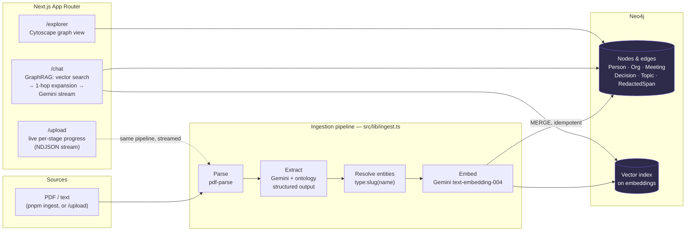
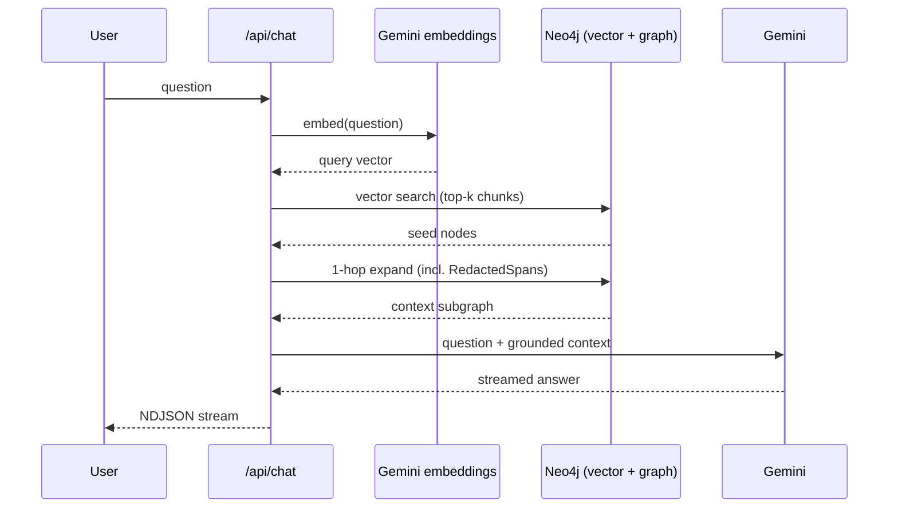

# Graphdossier

[](https://github.com/Rohankumar8124/graphdossier/actions/workflows/ci.yml)
[](LICENSE)


**Turn a pile of released FOIA/RTI documents into a navigable map of who knew what, when — and what's still redacted.**

Graphdossier is an end-to-end investigative tool for government transparency records. It reads released documents (PDF or text), uses an LLM with an ontology-guided schema to extract the people, organizations, meetings, decisions, and topics inside them, and assembles everything into a Neo4j knowledge graph you can question in plain English or explore visually.

Its signature idea: **every redaction is a first-class node in the graph.** A blacked-out span isn't an absence — it's a `RedactedSpan` node carrying its legal exemption code (b4 commercial, b5 deliberative, b6 privacy…) and the surrounding context that hints at what was concealed. Redactions become queryable investigative leads.

Built with **Gemini** (extraction + embeddings + answering), **Neo4j** (graph + vector index), and **Next.js / TypeScript**.

<p align="center">
  
</p>

### Contents

[Why this exists](#why-this-exists) · [Who it's useful for](#who-its-useful-for-and-the-impact) · [Feature tour](#what-it-does-feature-tour) · [Architecture](#architecture) · [Getting started](#getting-started) · [Demo corpus](#the-demo-corpus-project-greenfield) · [Scripts](#scripts) · [Tech stack](#tech-stack) · [Roadmap](#roadmap)

---

## Why this exists

Millions of pages of government records are released every year through FOIA (US) and RTI (India) requests — and most of them are read by nobody. The information that matters is rarely in one document; it's in the *network across documents*: the same consultant appearing on both sides of a deal, a meeting that happens right before a decision, a report that vanishes from the record after one email.

Existing tools don't surface that network:

| Tool | What it does | What it misses |
| --- | --- | --- |
| DocumentCloud & full-text readers | Search the words | Relationships between entities across documents |
| Aleph (OCCRP) | Cross-reference entities | Tuned to leaks/sanctions data, heavy to operate |
| Manual review | Everything, eventually | Weeks of a journalist's time per dump |

Graphdossier reconstructs the **who-talked-to-whom-when** graph automatically, and — uniquely — treats what the government *chose to hide* as data. You can literally ask: *"What's hidden, and who's hiding it?"*

## Who it's useful for, and the impact

- **Investigative journalists** — a document dump that takes weeks to cross-reference by hand becomes an explorable graph in minutes. Alias resolution alone ("Robert Calloway" / "Bob" / "R. Calloway" → one Person node) removes an entire class of missed connections.
- **Civic-tech and transparency groups** — redaction patterns become measurable: which agencies redact most, under which exemptions, around which topics.
- **Researchers and students of public policy** — the graph is a dataset: meeting chains, decision timelines, and influence networks extracted from primary sources, grounded with citations back to the original documents.
- **Anyone filing RTI/FOIA requests** — knowing *what sits behind a b(4) redaction next to a contamination report* tells you exactly what to request next. Graphdossier turns redactions into a roadmap for the follow-up request.

The broader point: transparency laws only create accountability if someone can actually process what gets released. Graphdossier demonstrates that modern LLM + knowledge-graph pipelines can close that gap — the same GraphRAG architecture used on enterprise data, pointed at the public interest.

---

## What it does (feature tour)

- **Ontology-guided extraction** — Gemini structured output constrained by a fully-specified Zod schema. The ontology (`src/lib/ontology.ts`) is the single source of truth: node types (`Person`, `Organization`, `Document`, `Meeting`, `Topic`, `Decision`, `RedactedSpan`…), allowed relationship triples, and display colors. Extraction cannot invent types the graph doesn't know.
- **Entity resolution** — extracted entities are canonicalized (`type:slug(name)`) so aliases and repeated mentions across documents collapse into single nodes.
- **Redactions as data** — each `RedactedSpan` records its exemption code and surrounding context, is linked to its document and nearby entities, and is ringed in red in the explorer.
- **GraphRAG chat (`/chat`)** — questions are answered by vector search over embedded content, followed by one-hop graph expansion (including attached redactions), then a streamed Gemini answer grounded in the retrieved records.
- **Visual explorer (`/explorer`)** — the whole graph rendered with Cytoscape: filter by type, inspect nodes, follow the meeting chains.
- **Runtime ingestion with a live pipeline view (`/upload`)** — drop one or many PDFs/text files into the running app and watch the pipeline work in real time: a per-file queue with remaining count, a stage stepper (parse → extract → resolve → embed → write nodes → write edges) with live counts (e.g. "Write nodes 12/34"), per-edge activity messages, and an activity log. Progress streams from the server as NDJSON, the same idiom the chat endpoint uses; one failed file doesn't stop the batch.
- **Idempotent graph writes** — ingestion uses `MERGE` with constraints, and the vector index is created on startup; re-ingesting is safe.
- **Fail-fast configuration** — the environment is validated with Zod at boot (`src/lib/config.ts`), and the embedding dimension is measured at runtime rather than hardcoded, so switching embedding models can't silently corrupt the vector index.

## Architecture

Graphdossier is two pipelines sharing one graph: an **ingestion pipeline** that turns raw documents into typed nodes and edges, and a **retrieval pipeline** (GraphRAG) that turns a plain-English question into a grounded, streamed answer. Both are ontology-guided — nothing gets written or retrieved outside the types defined in `src/lib/ontology.ts`.



**Ontology-guided, end to end.** `src/lib/ontology.ts` defines every node type, every allowed relationship triple, and display colors. Extraction is a Gemini structured-output call constrained to that schema, so the model can't invent a type or a dangling relationship — and the graph, chat retrieval, and explorer all read the same contract.

**Redactions are nodes, not gaps.** Each `RedactedSpan` is written like any other entity — exemption code, surrounding context, and edges to the document and entities it sits next to — so it's queryable and shows up in both chat answers and the explorer (ringed in red).

**GraphRAG answer flow** (`src/lib/rag.ts`, served by `src/app/api/chat/route.ts`):



### Key modules

| File | Role |
| --- | --- |
| `src/lib/ontology.ts` | Single source of truth: node types, relationships, allowed triples, colors. `RedactedSpan` is a node type. |
| `src/lib/config.ts` | Zod-validated env config (fails fast with a readable error). |
| `src/lib/gemini.ts` | Gemini chat + embeddings; embedding dimension is **measured at runtime**, never hardcoded. |
| `src/lib/extraction.ts` | Ontology-guided extraction via Gemini structured output (fully-specified Zod schema). |
| `src/lib/ingest.ts` | Extract → resolve entities (`type:slug(name)`) → embed → MERGE into Neo4j. |
| `src/lib/neo4j.ts` | Driver, idempotent schema (constraints + vector index). |
| `src/lib/rag.ts` | GraphRAG: vector search + one-hop graph/redaction enrichment. |
| `src/app/api/*` | `chat` (NDJSON stream), `graph`, `upload`, `stats`. |
| `src/components/GraphCanvas.tsx` | Cytoscape graph rendering. |
| `scripts/ingest.ts` | CLI ingestion from a corpus manifest. |

<details>
<summary><strong>Full project structure</strong></summary>

```
src/
├── app/
│   ├── api/
│   │   ├── chat/route.ts      # GraphRAG answer, streamed as NDJSON
│   │   ├── graph/route.ts     # full graph for the explorer
│   │   ├── stats/route.ts     # node/edge/redaction counts
│   │   └── upload/route.ts    # runtime ingestion, streamed progress
│   ├── chat/page.tsx          # chat UI
│   ├── explorer/page.tsx      # graph explorer UI
│   ├── upload/page.tsx        # multi-file upload + live pipeline view
│   └── page.tsx                # landing page
├── components/
│   ├── GraphCanvas.tsx         # Cytoscape rendering
│   └── Stats.tsx
├── lib/
│   ├── config.ts                # Zod-validated env config
│   ├── extraction.ts            # ontology-guided Gemini extraction
│   ├── gemini.ts                 # chat + embeddings client
│   ├── ingest.ts                  # extract → resolve → embed → write
│   ├── neo4j.ts                    # driver, constraints, vector index
│   ├── ontology.ts                  # node/relationship schema (source of truth)
│   ├── rag.ts                        # vector search + graph expansion
│   └── types.ts
└── types/pdf-parse.d.ts
scripts/ingest.ts                # CLI: build the graph from a corpus manifest
corpus/greenfield/                 # synthetic demo FOIA release
```

</details>

## Getting started

### 1. Prerequisites

- Node 20+ and `pnpm`
- A **Gemini API key** — https://aistudio.google.com/apikey
- A **Neo4j** instance — [Aura free tier](https://neo4j.com/cloud/aura/) works, or local Neo4j 5.x+

### 2. Configure

```bash
cp .env.example .env.local
# fill in GEMINI_API_KEY, NEO4J_URI, NEO4J_PASSWORD
```

### 3. Install & load the demo corpus

```bash
pnpm install
pnpm ingest --reset    # builds the graph from the Project Greenfield corpus
```

### 4. Run

```bash
pnpm dev               # http://localhost:3000
```

## The demo corpus: Project Greenfield

`corpus/greenfield/` is a **synthetic** FOIA release: a fictional city fast-tracks a riverside development while a contamination finding is quietly buried. Seven documents (memos, an email thread, a lab report, closed-session minutes, a whistleblower letter, an invoice) are engineered so every engine feature fires predictably:

- **Aliases** — "Robert Calloway" / "Bob" / "R. Calloway" collapse to one Person.
- **Hidden meeting chain** — memos → emails → a closed-session meeting → the vote.
- **Undisclosed dual role** — a consultant working for both the developer and the city.
- **Redactions** — b(4) commercial, b(5) deliberative, b(6) personal privacy, each attached to the entities it shields.

Try asking on `/chat`:

> *Who buried the Atwater Mill contamination report, and how?*
>
> *What's hidden behind the redactions, and which exemptions are cited?*

The same pipeline runs on real public releases (Clinton emails, FBI Vault, MuckRock sets) — drop a PDF on `/upload` to try one.

## Scripts

| Command | Description |
| --- | --- |
| `pnpm dev` | Run the app |
| `pnpm ingest [--reset] [--dir <path>]` | Build the graph from a corpus manifest |
| `pnpm typecheck` | `tsc --noEmit` |
| `pnpm lint` | ESLint |
| `pnpm build` | Production build |

## Tech stack

Next.js 16 (App Router, React 19) · TypeScript · Neo4j 5 + native vector index · Gemini 2.0 Flash + text-embedding-004 · LangChain core · Zod 4 · Cytoscape · Tailwind CSS 4

## Roadmap

- Timeline view — the same graph on a time axis (meeting chains as sequences)
- Redaction analytics — exemption-code statistics per agency and topic
- OCR ingestion for scanned releases
- Multi-corpus workspaces

---

> ⚠️ The demo data is fictional. Names, events, and findings are invented for demonstration and resemble no real persons or projects.

## License

MIT — see [LICENSE](LICENSE).
